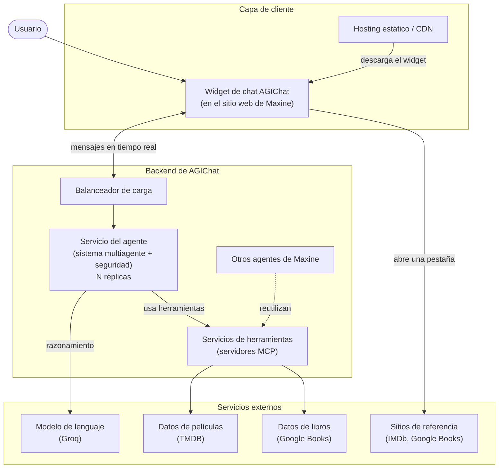
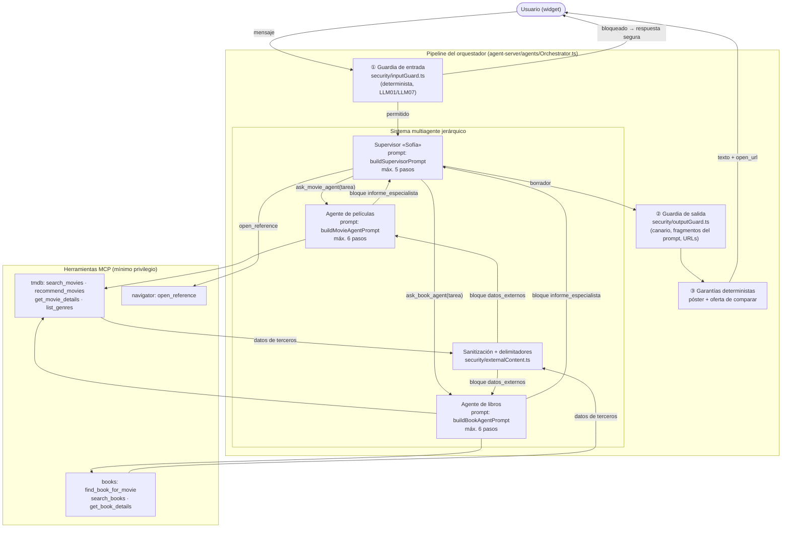
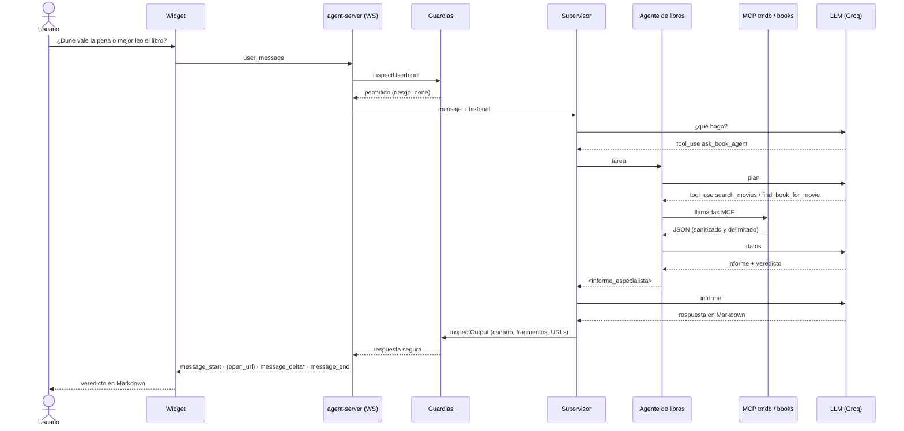

# Agente de películas de Maxine (Proyecto #2)

Este documento describe el sistema de inteligencia artificial que se conecta al widget del
Proyecto #1: un **sistema multiagente (MAS)** que recomienda películas con The Movie Database
(TMDB), las compara con su libro usando Google Books y abre IMDb o Google Books en una pestaña
nueva. Las herramientas están abstraídas en **servidores MCP** reutilizables por otros agentes.

- Seguridad (OWASP LLM01 y LLM07) y evals: [`SEGURIDAD_Y_EVALS.md`](SEGURIDAD_Y_EVALS.md)
- Arquitectura del widget (Proyecto #1): [`ARQUITECTURA.md`](ARQUITECTURA.md)

## 1. Requisitos y dónde se cumplen

| Requisito                                             | Implementación                                                                                                                                                                  |
| ----------------------------------------------------- | ------------------------------------------------------------------------------------------------------------------------------------------------------------------------------- |
| Comunicarse por el widget del Proyecto #1             | `agent-server/createAgentServer.ts` habla el mismo protocolo WebSocket (`src/core/protocol.ts`). El widget se conecta con `WebSocketTransport`, **sin cambios en la UI base**.  |
| Recomendar películas con la API de TMDB               | Servidor MCP `mcp-servers/tmdb` (`search_movies`, `recommend_movies`, `get_movie_details`, `list_genres`) y el agente especialista de películas.                                |
| Logo / atribución de TMDB                             | Componente `Attribution` + `TMDB_ATTRIBUTION` (logo oficial y aviso de la sección 3 de los términos de la API) al pie del widget.                                               |
| Comparar con el libro y decidir si vale la pena verla | Servidor MCP `mcp-servers/books` (`find_book_for_movie`, …) y el agente especialista de libros, que da un veredicto.                                                            |
| Anunciar que puede comparar con el libro              | El prompt del supervisor lo pide y, además, el orquestador lo agrega de forma determinista si la película tiene `basedOnBook = true` y la respuesta no lo menciona.             |
| Abrir IMDb / Google Books en una pestaña **sin clic** | Servidor MCP `mcp-servers/navigator` (`open_reference`) → evento `open_url` del protocolo → el widget llama a `window.open` al recibirlo.                                       |
| Mostrar el póster de la película                      | `posterUrl` de TMDB en Markdown (``); el orquestador lo agrega si el modelo lo omite; `MarkdownContent` solo carga imágenes confiables. |
| Reforzado contra LLM01 y LLM07                        | Guardias de entrada, de datos externos y de salida, prompts endurecidos, mínimo privilegio. Ver [`SEGURIDAD_Y_EVALS.md`](SEGURIDAD_Y_EVALS.md).                                 |
| Herramientas abstraídas en MCP Servers                | Tres servidores MCP independientes (stdio) que cualquier cliente MCP puede usar.                                                                                                |
| Evals de uso correcto y de ataques LLM01 / LLM07      | `evals/` (`npm run evals` sin red y `npm run evals:live` con el modelo real).                                                                                                   |

## 2. Diagrama de arquitectura de alto nivel

Vista general del sistema: muestra **los bloques principales y cómo se comunican**, sin detalles
de implementación. La organización interna de los agentes (supervisor, especialistas, guardias)
está en la [sección 6](#6-arquitectura-de-bajo-nivel-organización-de-los-agentes).



| Bloque                    | Responsabilidad                                                                                             |
| ------------------------- | ----------------------------------------------------------------------------------------------------------- |
| Widget de chat            | Interfaz del usuario: envía mensajes, muestra respuestas y pósters, abre IMDb o Google Books.               |
| Hosting estático / CDN    | Sirve el widget como archivos estáticos; no consume recursos del backend.                                   |
| Balanceador de carga      | Reparte las conexiones entre las réplicas del servicio del agente.                                          |
| Servicio del agente       | Sistema multiagente que entiende la petición, decide qué herramientas usar, aplica la seguridad y responde. |
| Servicios de herramientas | Acceso a películas, libros y navegación mediante servidores MCP, reutilizables por otros agentes.           |
| Servicios externos        | Modelo de lenguaje y fuentes de datos (TMDB, Google Books) a los que se accede por API.                     |

## 3. ¿Por qué escala?

1. **Capas desacopladas por puertos.** El widget solo conoce `ChatTransport`; el orquestador
   solo conoce `LlmProvider` y `ToolExecutor`. Cambiar de modelo (o de proveedor), de transporte
   o de origen de datos es escribir un adaptador, sin tocar el resto.
2. **Servidor del agente sin estado compartido.** Cada conexión WebSocket guarda solo su
   historial reciente (máx. 20 turnos) y cada mensaje se procesa de forma independiente. Por
   eso se pueden levantar **N réplicas** detrás de un balanceador con sesiones fijas (sticky
   sessions). Si se necesita que una conversación sobreviva a la caída de una réplica, el
   historial se mueve a un almacén externo (Redis) sin cambiar el orquestador.
3. **Herramientas como servicios MCP independientes.** Cada servidor MCP es un proceso aparte
   con sus propias credenciales. Hoy se lanzan por stdio junto al agente; para escalar se pueden
   servir con el transporte **Streamable HTTP** del SDK de MCP como microservicios propios,
   escalarlos por separado (p. ej. más réplicas de TMDB que de navegación) y **reutilizarlos
   desde otros agentes** de Maxine sin copiar código.
4. **Trabajo acotado por mensaje.** Supervisor con máx. 5 pasos, especialistas con máx. 6, máx.
   2 pestañas por respuesta, `effort: low` y límite de mensajes por minuto por conexión: el costo
   y la latencia por usuario son predecibles, y un usuario no puede acaparar recursos.
5. **Cuotas de las APIs gratuitas.** TMDB y Google Books se consultan solo desde los servidores
   MCP, lo que permite agregar una caché compartida en ese punto (los términos de TMDB permiten
   guardar datos hasta 6 meses) para no superar las ~1000 solicitudes diarias de Google Books.
6. **Widget estático.** El SDK se sirve como archivos estáticos (CDN / GitHub Pages); no consume
   recursos del backend hasta que el usuario escribe.
7. **Calidad que escala con el equipo.** Cobertura ≥ 80 % obligatoria (hoy ~98 %), evals en el
   CI y GitHub Flow: más desarrolladores pueden contribuir sin romper el comportamiento ni la
   seguridad del agente.

## 4. Servidores MCP

| Servidor    | Herramientas                                                            | Credenciales                    | Notas                                                                                     |
| ----------- | ----------------------------------------------------------------------- | ------------------------------- | ----------------------------------------------------------------------------------------- |
| `tmdb`      | `search_movies`, `get_movie_details`, `recommend_movies`, `list_genres` | `TMDB_API_KEY`, `TMDB_LANGUAGE` | Solo lectura. Devuelve póster, IMDb y `basedOnBook`, con la atribución de TMDB.           |
| `books`     | `search_books`, `get_book_details`, `find_book_for_movie`               | `GOOGLE_BOOKS_API_KEY` (opc.)   | Solo lectura. `find_book_for_movie` puntúa candidatos (`matchScore`).                     |
| `navigator` | `open_reference`                                                        | —                               | Solo IMDb y Google Books, construidos desde ids validados; devuelve la acción `open_url`. |

Cada uno se puede ejecutar solo (`npm run mcp:tmdb`, `npm run mcp:books`, `npm run mcp:navigator`)
y registrarse en cualquier cliente MCP. Ejemplo para Claude Desktop:

```json
{
  "mcpServers": {
    "agichat-tmdb": {
      "command": "node",
      "args": ["/ruta/al/repo/mcp-servers/tmdb/main.ts"],
      "env": { "TMDB_API_KEY": "<tu llave>" }
    }
  }
}
```

## 5. Ejecutar el agente

```bash
cp .env.example .env      # completa TMDB_API_KEY y GROQ_API_KEY
npm run agent-server      # ws://127.0.0.1:8788 (lanza los 3 servidores MCP)
npm run dev               # demo: Configurar demo → Backend → Agente real
```

También se puede abrir directamente <http://localhost:5173/?transport=agent>.

**Ventanas emergentes.** El widget abre la pestaña con `window.open` en cuanto llega el evento
`open_url`. Como la respuesta del agente tarda unos segundos, el navegador puede considerarla una
ventana emergente no solicitada: si la bloquea, el widget lo indica y deja el enlace para abrirla
con un clic. Para que se abra siempre sin clic, permite las ventanas emergentes para el sitio, o
ejecuta el agente en la misma máquina con `NAVIGATOR_OPEN_ON_HOST=true` (el servidor MCP abre la
pestaña con el navegador predeterminado y el widget no la duplica).

## 6. Arquitectura de bajo nivel: organización de los agentes

### Componentes internos

| Componente                  | Carpeta             | Responsabilidad                                                                                                                                                                                                     |
| --------------------------- | ------------------- | ------------------------------------------------------------------------------------------------------------------------------------------------------------------------------------------------------------------- |
| Widget (SDK)                | `src/`              | UI del chat; abre las pestañas pedidas (`open_url`), muestra pósters seguros y la atribución de TMDB.                                                                                                               |
| Servidor del agente         | `agent-server/`     | WebSocket, orquestación multiagente, guardias de seguridad, configuración.                                                                                                                                          |
| Puerto + adaptadores de LLM | `agent-server/llm/` | `LlmProvider` (puerto), `OpenAICompatibleProvider` (Groq por defecto; NVIDIA, Gemini, …), `RetryingProvider` (reintentos ante límites), `AnthropicProvider` (Claude, opcional), `ScriptedProvider` (tests y evals). |
| Cliente MCP                 | `agent-server/mcp/` | `McpToolbox` descubre las herramientas de los servidores MCP y enruta las llamadas.                                                                                                                                 |
| Servidores MCP              | `mcp-servers/`      | Herramientas reutilizables: TMDB, Google Books y navegación.                                                                                                                                                        |
| Evals                       | `evals/`            | Casos funcionales y de ataques, evaluador, reporte y ablación.                                                                                                                                                      |

### Clasificación

El sistema es **jerárquico (supervisor–trabajadores) y centralizado en el supervisor**,
**combinado con un pipeline** de capas deterministas de seguridad:

- **Jerárquico:** hay dos niveles. El **supervisor** (Sofía) recibe el mensaje, decide qué hacer
  y delega en los **especialistas** (agente de películas y agente de libros), que no se comunican
  entre sí ni con el usuario: solo reportan al supervisor.
- **Centralizado:** el supervisor es el único que conversa con el usuario, el único que puede
  abrir pestañas (`open_reference`) y quien redacta la respuesta final. Los especialistas
  funcionan como "agentes como herramientas" (`ask_movie_agent`, `ask_book_agent`).
- **Pipeline:** antes y después del MAS hay etapas fijas que no dependen del modelo:
  guardia de entrada → MAS → guardia de salida → garantías deterministas (póster y oferta de
  comparar con el libro).

Se descartó una organización **descentralizada** (agentes que negocian entre sí): con solo dos
dominios (películas y libros) añade latencia y llamadas al modelo sin beneficio, y hace más
difícil auditar quién decidió abrir una pestaña o qué datos llegaron al usuario.

### Diagrama de la organización



| Agente     | Rol                                                         | Herramientas permitidas                                                                         | Habla con        |
| ---------- | ----------------------------------------------------------- | ----------------------------------------------------------------------------------------------- | ---------------- |
| Supervisor | Entiende la intención, delega, abre pestañas y responde.    | `ask_movie_agent`, `ask_book_agent`, `open_reference`                                           | Usuario y equipo |
| Películas  | Busca, recomienda y obtiene detalles (póster, IMDb, libro). | `search_movies`, `recommend_movies`, `get_movie_details`, `list_genres`                         | Supervisor       |
| Libros     | Encuentra el libro fuente, compara y da un veredicto.       | `search_movies`, `get_movie_details`, `find_book_for_movie`, `search_books`, `get_book_details` | Supervisor       |

Aunque el modelo de un especialista "invente" una herramienta que no está en su lista, el código
la rechaza (`runSpecialist`). Ningún especialista puede navegar.

### Secuencia: «¿Dune vale la pena o mejor leo el libro?»



### Protocolo agregado

| Dirección        | Evento     | Campos                                  | Efecto en el widget                                             |
| ---------------- | ---------- | --------------------------------------- | --------------------------------------------------------------- |
| Backend → Widget | `open_url` | `id`, `url`, `label`, `openedByServer?` | Valida la URL (lista permitida) y la abre en una pestaña nueva. |
